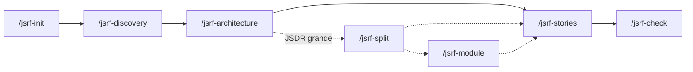

# jsrf-skills

Skills de Agent para conduzir **refinamentos técnicos** de features no ecossistema JSRF/Jeitto: do discovery de negócio até as histórias técnicas prontas para a sprint, passando pelo documento de arquitetura (**JSDR**) e uma auditoria final contra o código real.

Todos os artefatos são gerados em `refinamentos/<feature-slug>/` no diretório onde o Claude Code está rodando.

---

## Instalação

Rode o script de instalação. Por padrão ele coloca todas as skills em `~/.agents/skills/`:

```bash
./install.sh                               # copia para ~/.agents/skills
./install.sh --link                        # cria symlinks: alterações no repo valem na hora
./install.sh --integration claude          # instala no diretório do Claude Code
./install.sh --integration claude,codex    # vários agentes de uma vez
```

| `--integration` | Diretório |
|-----------------|-----------|
| `agents` (padrão) | `~/.agents/skills` |
| `claude` | `~/.claude/skills` |
| `codex` | `~/.codex/skills` |
| `gemini` | `~/.gemini/skills` |
| `opencode` | `~/.config/opencode/skills` |

Instale sempre todas as skills juntas: o `jsrf-module` lê os padrões definidos no `jsrf-architecture`.

Abra uma nova sessão do Claude Code e as skills aparecem como comandos `/jsrf-*`. Elas também são acionadas automaticamente por frases como "vamos refinar", "gerar JSDR" ou "gerar histórias".

> 💡 Rode o Claude Code a partir de um diretório que tenha acesso aos repositórios envolvidos na feature (ou adicione-os com `/add-dir`), pois várias skills inspecionam o código-fonte.

---

## Visão geral

| Skill | Papel | Entrada | Saída |
|-------|-------|---------|-------|
| [`jsrf-init`](jsrf-init/SKILL.md) | Cria a pasta do refinamento e o briefing | descrição da feature, repo (opc.), slug (opc.) | `refinamentos/<slug>/README.md` |
| [`jsrf-discovery`](jsrf-discovery/SKILL.md) | Entrevista de negócio (grill-me) | nome da feature | `refinamentos/.refinement-context/<slug>/discovery.md` |
| [`jsrf-architecture`](jsrf-architecture/SKILL.md) | Mapeia componentes, contratos e diagramas | `<slug>` + discovery | `JSDR.md` + `.components.md` |
| [`jsrf-split`](jsrf-split/SKILL.md) | Divide um JSDR grande em módulos de negócio (opcional) | `<slug>` + JSDR + `.components.md` | `modulos/<modulo>/JSDR.md` + `.components.md` |
| [`jsrf-module`](jsrf-module/SKILL.md) | Evolui a sub-JSDR de um módulo: novas capacidades, contratos alterados, remoções | `<slug>` + `[modulo]` + descrição da mudança | sub-JSDR atualizada + raiz e módulos impactados sincronizados |
| [`jsrf-stories`](jsrf-stories/SKILL.md) | Quebra o JSDR (ou a sub-JSDR do módulo) em uma história por componente novo | `<slug>` + `[modulo]` | `stories/<ACRONYM>-STORY-00X.md` |
| [`jsrf-check`](jsrf-check/SKILL.md) | Audita as histórias contra o código real | `<slug>` + `[modulo]` + lista de histórias (ou "todas") | `CHECK_REPORT.md` |

---

## Fluxo de uso



0. **`/jsrf-init`** (opcional)
   Informe a descrição da feature e, opcionalmente, o repositório e o slug. Se o slug não for informado, ele é gerado em kebab-case a partir da descrição. Cria `refinamentos/<slug>/README.md` com o briefing e indica o discovery como próximo passo.

1. **`/jsrf-discovery Checkout Pix`**
   O Claude faz **uma pergunta por vez**: contexto de negócio, se é feature nova ou evolução, aplicações e repositórios envolvidos, novas aplicações, restrições, critério de sucesso e dúvidas em aberto. Ao final, pede acesso aos repositórios e salva o `discovery.md`.

2. **`/jsrf-architecture checkout-pix`**
   Lê o discovery, explora os repositórios (stack, rotas, workers, filas, convenções) e faz uma nova rodada de perguntas técnicas (paths, nomes de tópicos, integrações externas, regras de imutabilidade/auditoria). Gera:
   - `JSDR.md` com diagrama de serviços (`graph LR`), sequência do caminho feliz, ER (se houver tabelas novas), mapa de componentes `C01…` e contratos.
   - `.components.md`, usado pela fase seguinte.

2.5. **`/jsrf-split checkout-pix`** (opcional, para JSDRs grandes)
   Avalia se o JSDR é grande o suficiente para ser dividido e propõe **módulos de negócio** (ex.: `cliente`, `cashin`, `cashout`), atribuindo cada componente a exatamente um módulo. Depois de confirmar as fronteiras com você, gera em `refinamentos/<slug>/modulos/<modulo>/` uma sub-JSDR autocontida (contratos copiados, diagramas próprios, dependências de outros módulos) e o `.components.md` do módulo. O JSDR raiz ganha a seção **10. Módulos**, com o índice e o grafo de dependências.

2.6. **`/jsrf-module checkout-pix cashin`** (opcional, para evoluir um módulo)
   Mesmo papel do `jsrf-architecture`, mas restrito a um módulo: entende a mudança (nova capacidade, contrato alterado, regra nova ou remoção), explora o código e faz as perguntas técnicas. Antes de editar, mostra o plano com o impacto em outros módulos e nas histórias existentes. Depois atualiza a sub-JSDR, registra a mudança no **Histórico de alterações** e sincroniza o `.modules.md`, o JSDR raiz e os contratos copiados nos módulos que consomem os componentes alterados. Novos componentes recebem IDs globais, nunca reutilizados.

3. **`/jsrf-stories checkout-pix`**
   Propõe a ordem de implementação (infra antes de consumidores, o que pode rodar em paralelo) e **pede confirmação**. Depois gera uma história por componente novo com diagrama de sequência completo (sucesso, erros e idempotência), contrato, validações campo a campo, regras de negócio, integrações, exceções, observabilidade e plano de testes. Por fim, atualiza a seção 9 do JSDR.
   Os arquivos são nomeados com o acrônimo do slug: `checkout-pix` → `CP-STORY-001.md`.
   Se já houver histórias, a skill trabalha de forma incremental: gera só as dos componentes novos, reescreve as marcadas como `Revisar` e sinaliza as `Obsoleta`.
   Se o refinamento tiver módulos, a skill pergunta de qual módulo se trata (ou use `/jsrf-stories checkout-pix cashin`) e trabalha só dentro dele: `modulos/cashin/stories/CP-CASHIN-STORY-001.md`.

4. **`/jsrf-check checkout-pix`** (opcional, recomendado)
   Cruza cada história com o código-fonte (endpoints, DTOs, tópicos, migrations, quality gates) e gera `refinamentos/<slug>/CHECK_REPORT.md` com status 🟢 / 🟡 / 🔴 e as ações recomendadas antes da sprint. Com módulos, pergunta qual auditar (ou "todos"), valida também as fronteiras entre módulos e grava o relatório em `modulos/<modulo>/CHECK_REPORT.md`.

---

## Exemplo rápido

```text
> /jsrf-init Checkout com Pix para o app
  Refinamento inicializado em refinamentos/checkout-pix/

> /jsrf-discovery checkout-pix
  ... responda às perguntas, uma por vez ...
  Discovery salvo.

> /jsrf-architecture checkout-pix
  ... responda às perguntas técnicas ...
  JSDR gerado em refinamentos/checkout-pix/JSDR.md

> /jsrf-stories checkout-pix
  ... confirme a ordem das histórias ...

> /jsrf-check checkout-pix todas
```

Estrutura resultante:

```text
refinamentos/
├── .refinement-context/
│   └── checkout-pix/
│       └── discovery.md
└── checkout-pix/
    ├── README.md
    ├── JSDR.md
    ├── .components.md
    ├── CHECK_REPORT.md
    └── stories/
        ├── CP-STORY-001.md
        └── CP-STORY-002.md
```

Com `/jsrf-split`, as histórias e o relatório ficam dentro de cada módulo:

```text
refinamentos/checkout-pix/
├── JSDR.md                 # visão macro + seção 10. Módulos
├── .components.md
└── modulos/
    ├── .modules.md
    ├── cliente/
    │   ├── JSDR.md
    │   ├── .components.md
    │   ├── CHECK_REPORT.md
    │   └── stories/CP-CLIENTE-STORY-001.md
    └── cashin/
        ├── JSDR.md
        ├── .components.md
        └── stories/CP-CASHIN-STORY-001.md
```

---

## Padrões aplicados pelas skills

As skills impõem as convenções JSRF. Vale conhecê-las para revisar o que for gerado:

- **Tópicos Pub/Sub:** `[domain].[business-domain].[event|command].[entity].[action].[vX]_[DLT]`. Eventos usam verbo no passado (`created`) e comandos usam o infinitivo (`process`). Ex.: `finance.command.payment.process.v1`.
- **Banco de dados:** `snake_case` em inglês, tabelas no plural, prefixos `pk_`, `fk_`, `uq_`, `idx_`, `vw_`, `fn_`, `trg_`, campos de auditoria `created_at` / `updated_at` / `deleted_at` e `COMMENT ON` em português.
- **Arquitetura hexagonal:** `src/adapters/{input,output}`, `src/domain`, `src/infrastructure`. O `domain/` nunca importa de `adapters/`.
- **Exceções:** `BusinessException` (log INFO, 422 com código) e `InfrastructureException` (log ERROR + Datadog, 500 genérico).
- **Observabilidade:** `loguru` em JSON, `LOG_CONTEXT`, propagação de `x-trace-id` / `x-correlation-id` e nenhuma PII em logs.
- **Quality gates:** testes de integração cobrindo todos os critérios de aceite, 100% de cobertura unitária e zero mutantes sobreviventes.

---

## Dicas

- Responda às sessões *grill-me* com calma: a qualidade do JSDR e das histórias depende diretamente dessas respostas.
- Revise o `JSDR.md` antes de gerar as histórias. Ajustes nos contratos são mais baratos nessa etapa.
- Use `/jsrf-split` quando o JSDR misturar capacidades de negócio distintas. Cada módulo vira um contexto menor e independente para quem for desenvolver.
- Se uma skill reclamar de pré-requisito ausente (por exemplo, `discovery.md` ou `.components.md`), rode a fase anterior do fluxo.
