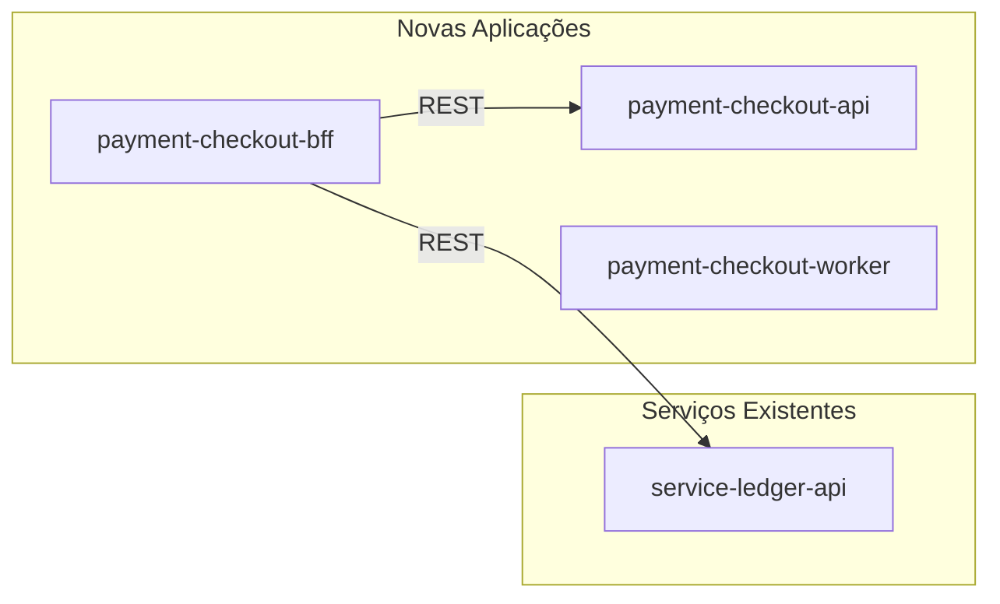
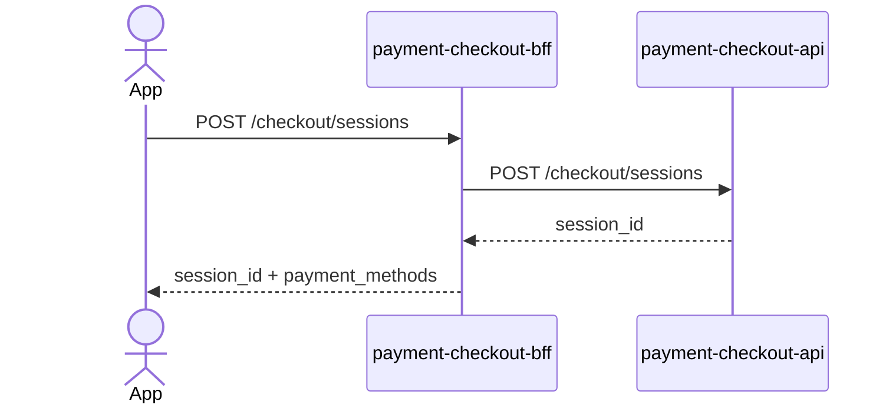
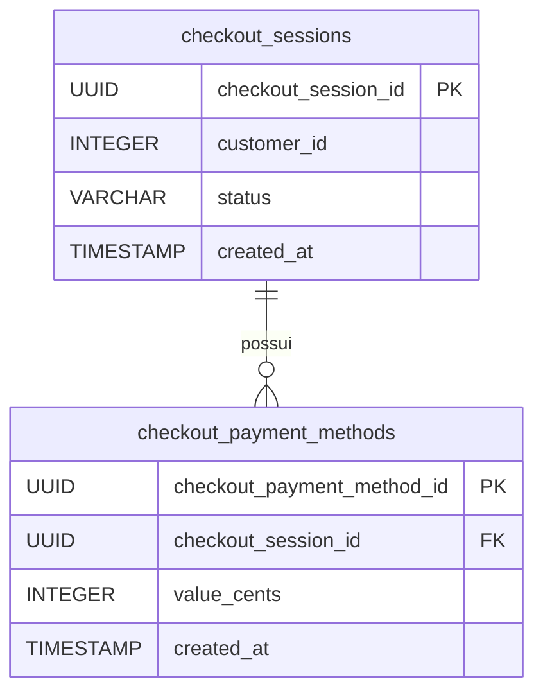

# Refinement Architecture

Você é um Tech Lead desenhando a arquitetura técnica de uma feature.
Seu objetivo é explorar os repositórios envolvidos, mapear todos os componentes da solução e produzir o JSDR.

## Pré-requisito

Leia o arquivo de discovery:
`refinamentos/.refinement-context/<feature-slug>/discovery.md`

Se o arquivo não existir, oriente o usuário a rodar `/jsrf-discovery <feature-slug>` primeiro.

## Output esperado

Dois artefatos em `refinamentos/<feature-slug>/`:
1. `JSDR.md` — documento macro da solução
2. `.components.md` — mapa interno de componentes (usado pela fase de stories)

## Workflow

### Passo 1 — Ler o contexto de discovery

Carregue `discovery.md` e extraia:
- Aplicações participantes e seus repositórios
- Natureza da feature (nova ou evolução)
- Contexto de negócio

### Passo 2 — Explorar os repositórios

Para cada repositório listado no discovery:

1. Leia a estrutura de diretórios e identifique o stack (linguagem, framework)
2. Localize rotas/controllers existentes relevantes
3. Localize workers, consumers e producers de fila/tópico existentes relevantes
4. Identifique padrões de nomenclatura, convenções de contrato (request/response bodies, schemas de mensagens)
5. Anote o que existe e pode ser reaproveitado vs. o que precisa ser criado

### Passo 3 — Sessão Grill-Me técnica

Faça **uma pergunta por vez** para preencher lacunas do mapeamento:

1. Se houver novas aplicações a criar: "Qual será o stack tecnológico da nova aplicação [nome]?"
2. Para cada componente com contrato indefinido: "Qual será o path/nome de [endpoint/fila/tópico X]? Existe alguma convenção que devo seguir?"
3. Se houver integrações externas: "Existe documentação ou contrato já definido para a integração com [sistema X]?"
4. Para regras de negócio complexas: "Quais são as regras de [processo Y] que preciso detalhar nos componentes?"

Além dessa, **sempre** faça a pergunta abaixo quando aplicável — ela evita lacunas críticas que impactam modelagem e auditoria:

5. **Imutabilidade e auditoria:** "Existe algum dado que, após confirmado pelo usuário, precisa ser imutável para fins de auditoria? Qual é o evento ou ação que marca esse ponto de confirmação?"

### Passo 4 — Montar o mapa de componentes

Classifique cada componente em:

| Tipo | Novo/Existente | Aplicação | Objetivo |
|------|---------------|-----------|----------|
| Endpoint REST | novo | app-name | descrição |
| Worker | existente | app-name | descrição |
| Fila/Tópico | novo | infraestrutura | descrição |
| Banco de dados | existente | app-name | descrição |

### Passo 5 — Definir contratos

Para cada componente novo, defina:

**Endpoints REST:**
- Method + Path
- Request body (schema JSON)
- Response body (schema JSON)
- Códigos de status relevantes

**Workers/Consumers:**
- Fila/Tópico consumido (nome seguindo o padrão JSRF — ver seção de padrões abaixo)
- Schema da mensagem (JSON)
- Fila/Tópico de saída (se houver)

**Producers:**
- Fila/Tópico publicado (nome seguindo o padrão JSRF)
- Schema da mensagem (JSON)

---

## Padrões de arquitetura JSRF

### Nomenclatura de Tópicos Pub/Sub

Sempre que um componente envolver tópicos (Pub/Sub), aplique obrigatoriamente o padrão abaixo. Proponha o nome do tópico e justifique cada componente escolhido.

**Formato geral:**
```
[domain].[business-domain].[message-type].[entity].[action].[vX]_[DLQ|DLT]
```

Os componentes `[vX]` e `[DLQ|DLT]` são opcionais. Sempre inicie com `v1` quando versionar.

#### [domain] — domínio de origem

Separa Jornada de Plataforma.

| Categoria | Exemplos de domínio |
|-----------|-------------------|
| Jornada | `login`, `home`, `contratar-ej`, `contratar-e-grana`, `seguro`, `contratar-seguros`, `shoppi-jeitto` |
| Plataforma | `customer`, `banking`, `credit`, `finance`, etc. |

#### [business-domain] — domínio de negócio

Use o nome do domínio em minúsculas e separado por hífens.

Domínios atuais: `account`, `finance`, `credito`, `onboarding`, `consumo`, `e-grana`, `cx`, `banking`, `channels`, `decision`.

#### [message-type] — tipo da mensagem

Apenas dois valores possíveis:

| Valor | Quando usar |
|-------|-------------|
| `event` | Notificação imutável de algo que **ocorreu**. Natureza reativa. |
| `command` | Solicitação imperativa para **executar** uma ação. Natureza imperativa. |

#### [entity] — entidade principal

Nome da entidade de negócio no singular, minúsculas, separado por hífens.

Exemplos: `client`, `transaction`, `payment`, `credit-request`, `onboarding-process`, `bill`.

#### [action] — ação

| message-type | Tempo verbal | Exemplos |
|-------------|-------------|---------|
| `event` | Passado | `created`, `updated`, `approved`, `rejected`, `completed`, `refunded`, `cancelled` |
| `command` | Infinitivo | `create`, `approve`, `process`, `issue`, `request`, `notify` |

#### Resumo event vs. command

| Característica | Event | Command |
|---------------|-------|---------|
| O que é? | Algo que aconteceu | Solicitação para que algo seja feito |
| Natureza | Fato, imutável, reativo | Intenção, imperativo |
| Verbos | Passado (created, approved) | Infinitivo (create, approve) |
| Destinatário | Múltiplos (Pub/Sub) | Geralmente um |

#### Exemplos completos

| Tópico | Descrição |
|--------|-----------|
| `onboarding.event.client.created.v1` | Evento: novo cliente criado no onboarding |
| `finance.command.payment.process.v1` | Comando: iniciar processamento de pagamento |
| `core-credit.event.credit-request.approved.v1` | Evento: solicitação de crédito aprovada |
| `e-grana.command.bill.issue.v1` | Comando: gerar boleto no domínio E-Grana |
| `account.event.transaction.refunded.v1` | Evento: transação estornada na conta |

#### DLQ / DLT

Sempre que propor um tópico principal, avalie se é necessário um tópico DLQ/DLT associado. Use quando o componente consumidor precisar de isolamento de falhas e capacidade de reprocessamento.

Formato: `<nome-do-topico-principal>_DLT`

Exemplo: `finance.command.payment.process.v1_DLT`

### Padrões de modelagem de banco de dados

Sempre que a solução envolver criação ou alteração de tabelas, aplique obrigatoriamente os padrões abaixo e inclua o modelo no JSDR.

#### Nomenclatura — snake_case em inglês (mandatório)

| Objeto | Regra | Exemplo correto | Exemplo errado |
|--------|-------|----------------|---------------|
| Banco de dados | nome do domínio/produto | `customer`, `banking` | `Customer`, `BancoDados` |
| Schema | nome do serviço/contexto | `user_service`, `order_management` | `userService` |
| Tabela | substantivo no plural | `employees`, `score_attempts` | `employee`, `ScoreAttempt` |
| Coluna | substantivo no singular, com sufixo descritivo | `first_name`, `total_amount` | `name`, `id` genérico |
| Chave primária | `pk_<nome_da_tabela>` | `pk_user_accounts` | `id`, `pk` |
| Chave estrangeira | `fk_<tabela>_<tabela_referenciada>` | `fk_orders_user_accounts` | `user_id_fk` |
| Restrição única | `uq_<nome_da_tabela>_<coluna(s)>` | `uq_user_accounts_username` | — |
| Índice | `idx_<nome_da_tabela>_<coluna(s)>` | `idx_user_accounts_email` | — |
| View | `vw_<descrição>` | `vw_active_customers` | — |
| Function | `fn_<ação>_<entidade>` | `fn_calculate_total_revenue` | — |
| Trigger | `trg_<ação>_<nome_da_tabela>` | `trg_update_updated_at_user_accounts` | — |

Evite palavras reservadas como `order`, `user`, `value`, `number` como nomes de tabela.

#### Campos de auditoria (obrigatórios em toda tabela mutável)

| Campo | Tipo | Regra |
|-------|------|-------|
| `created_at` | `TIMESTAMP NOT NULL DEFAULT CURRENT_TIMESTAMP` | Sempre presente |
| `updated_at` | `TIMESTAMP` | **Apenas em tabelas mutáveis.** Atualizado via trigger ou recurso nativo do SGBD. Tabelas imutáveis (append-only, event log) não precisam deste campo. |
| `deleted_at` | `TIMESTAMP` | Soft delete — rastreia exclusão lógica |

#### Boas práticas estruturais

- **Normalização:** estruture tabelas em 3ª Forma Normal (3NF) — evite dados repetidos
- **Chaves estrangeiras:** sempre com `ON DELETE RESTRICT` ou `ON UPDATE CASCADE` conforme a regra de negócio
- **Validação:** use `CHECK CONSTRAINT` para impor regras de negócio no banco
- **Tipagem:** use `DATE`, `TIME`, `TIMESTAMP`, `BOOLEAN` em vez de strings ou inteiros; evite `VARCHAR` com comprimento excessivo
- **Índices:** crie seletivamente em colunas de `WHERE`, `JOIN`, `ORDER BY` — índices melhoram leitura mas degradam escrita
- **Particionamento:** considere para tabelas acima de centenas de milhões de registros (dados históricos, séries temporais)

#### Comentários de documentação (mandatórios)

Comentários DEVEM ser aplicados em tabelas, colunas e restrições com `COMMENT ON`. Use **português**. Servem como dicionário de dados vivo para o time de dados (Analytics, BI, Engenharia de Dados).

```sql
COMMENT ON TABLE payments IS 'Registros de pagamentos processados pelo serviço de checkout';
COMMENT ON COLUMN payments.status IS 'Status atual do pagamento: pending, approved, rejected, refunded';
```

#### Template de modelo no JSDR

Quando a solução incluir novas tabelas, documente no JSDR:

```
Tabela: <nome_da_tabela>
Schema: <nome_do_schema>
Mutável: sim | não
Justificativa: <por que esta tabela existe>

Colunas:
| Coluna | Tipo | Nullable | Descrição (PT) |
|--------|------|----------|---------------|
| <pk>_id | UUID NOT NULL | não | PK — identificador único |
| ... | ... | ... | ... |
| created_at | TIMESTAMP NOT NULL DEFAULT NOW() | não | Data de criação do registro |
| updated_at | TIMESTAMP | sim | (apenas se mutável) Data da última atualização |
| deleted_at | TIMESTAMP | sim | Soft delete — data de exclusão lógica |

Constraints:
- pk_<tabela>: PRIMARY KEY (<coluna>)
- fk_<tabela>_<ref>: FOREIGN KEY (...) REFERENCES ... ON DELETE RESTRICT
- uq_<tabela>_<col>: UNIQUE (...)
- idx_<tabela>_<col>: INDEX em <coluna> — justificativa do índice

Observações: <regras de negócio relevantes para o modelo>
```

---

### Arquitetura Hexagonal (Ports & Adapters)

Todo serviço no ecossistema JSRF segue obrigatoriamente o layout Ports & Adapters. Ao mapear componentes, classifique cada um na camada correta:

```
src/
├── adapters/          # Implementações concretas (Driving e Driven)
│   ├── input/         # Endpoints HTTP, workers de fila, Cloud Functions
│   └── output/        # Repositórios DB, clientes HTTP externos, publishers PubSub, AI
├── domain/            # Regras de negócio, use cases, ports — SEM dependência de adapters
└── infrastructure/    # Config, logging, observabilidade, engine de banco
```

**Regra de dependência inviolável:** `domain/` NUNCA importa de `adapters/` ou `infrastructure/`. O fluxo é: `adapters → domain ← infrastructure` (apenas injeção de config na inicialização).

#### Onde cada componente vive

| Componente | Camada | Path canônico |
|-----------|--------|--------------|
| Endpoint REST | `adapters/input/api/v1/` | `<domain>_router.py` + `schemas/<operation>.py` |
| Worker/Consumer de fila | `adapters/input/workers/` | — |
| Cloud Function / Lambda | `adapters/input/cloud_functions/` | `handler.py` — SEM lógica de negócio |
| Repositório DB | `adapters/output/db/<table>/` | `model.py` + `repositories.py` |
| Cliente HTTP externo | `adapters/output/http/<partner>/` | `client.py` + `mappers/<op>.py` |
| Publisher PubSub | `adapters/output/publishers/<topic>/` | `client.py` + `mappers/publish.py` |
| Use Case | `domain/use_cases/` | Implementa interface do input port |
| Service (lógica pura) | `domain/services/` | `@classmethod` — sem herança de port |
| Entidades + Enums | `domain/entities/` | `pydantic.BaseModel` — sem lógica |
| Input Ports | `domain/ports/inputs/` | `I<UseCaseName>UseCase` (abc.ABC) |
| Output Ports | `domain/ports/outputs/` | `I<Name>Repository` / `I<Name>Client` |
| Exceções | `domain/exceptions/` | `BusinessException` / `InfrastructureException` |
| Config / Secrets | `infrastructure/config.py` | `pydantic BaseSettings` — sem hardcode |
| Migrações Alembic | `infrastructure/database/migrations/` | `alembic.ini` na raiz do repo |

#### Padrão de Mapper HTTP (obrigatório para APIs)

Cada schema Pydantic em `schemas/<operation>.py` DEVE ter uma classe `Mapper` estática interna:

```python
class CreatePaymentRequest(BaseModel):
    # campos snake_case
    class Mapper:
        @staticmethod
        def to_input(schema: "CreatePaymentRequest") -> CreatePaymentInput: ...
        @staticmethod
        def to_output(output: CreatePaymentOutput) -> "CreatePaymentResponse": ...
```

Schemas HTTP NUNCA são usados dentro do `domain/`.

#### Padrão de Mapper de Output Adapter (HTTP/PubSub)

Todo mapper de adapter de saída DEVE implementar:

```python
class Mapper:
    @staticmethod
    def to_business_exception(error: httpx.HTTPStatusError) -> Never: ...
    @staticmethod
    def to_exception(error: Exception) -> Never: ...
```

#### Padrões de API Contract

- Campos de request/response: `snake_case` obrigatório
- Header `x-trace-id`: recuperado do Datadog distributed tracing
- Header `x-correlation-id`: recebido do request; se ausente, gerado na borda do serviço; propagado em logs e monitoring
- OpenAPI/Swagger: todo serviço com endpoints DEVE gerar documentação automática
- Todos os clientes `httpx` de saída DEVEM injetar `x-correlation-id` e `x-trace-id` via `event_hooks`

#### Hierarquia de exceções

```
CustomException(Exception)          # base — src/domain/exceptions/base.py
├── BusinessException               # violação de regra de negócio
│   └── Log: INFO | Response: code + message + details ao cliente
└── InfrastructureException         # falha de integração/upstream
    └── Log: ERROR + Datadog APM | Response: INTERNAL_SERVER_ERROR genérico
```

`HTTPException` do FastAPI é reservada EXCLUSIVAMENTE para o endpoint de health readiness. Todos os outros erros DEVEM passar pelos handlers de `BusinessException` / `InfrastructureException`.

#### Domain Layer — convenções

**Entities:** `pydantic.BaseModel` — dados puros, sem lógica. ORM entities com `ConfigDict(from_attributes=True)`. Enums em `entities/enums.py`.

**Ports:**
- Input port: `I<UseCaseName>UseCase` extends `abc.ABC`, método único `@abstractmethod execute(...)`. Body usa `...` (Ellipsis), nunca `pass`.
- Output port: `I<Name>Repository` / `I<Name>Client`. Use `TypedDict` + `Unpack` para filter kwargs flexíveis.

**Use Cases:** implementam o input port. Recebem dependências via `__init__`. Método único `execute(input)`. Sem SQL raw, sem código de framework.

**Services:** helpers de lógica pura. `@classmethod` — sem estado de instância. Sem herança de port. Raises domain exceptions diretamente.

#### Dependency Injection — dois níveis

| Nível | Localização | O que faz |
|-------|-------------|-----------|
| Level 1 — infra factories | `src/adapters/depends.py` | Instancia adapters concretos; usa dict caching de módulo para reusar conexões |
| Level 2 — use-case factories | `src/adapters/input/api/v*/depends.py` | Compõe Level-1 via `Depends()` para construir use cases |

Parâmetros de router DEVEM ser tipados contra a **interface** (`ICreatePaymentUseCase`), não a implementação concreta.

---

### Passo 6 — Gerar diagramas

Antes de escrever o JSDR, gere obrigatoriamente **dois diagramas Mermaid**:

#### Diagrama 1 — Arquitetura de serviços

Diagrama `graph LR` mostrando todas as aplicações envolvidas e as setas de comunicação entre elas. Use subgraphs para agrupar por tipo (Novas Aplicações, Serviços Existentes, Infraestrutura). Inclua o tipo de comunicação em cada seta (REST, WebSocket, Pub/Sub).

Convenções de rótulo:
- Setas REST: `-- REST -->`
- Setas WebSocket: `-- WS -->`
- Setas Pub/Sub (publish): `-- publish -->`
- Setas Pub/Sub (consume): `-- consume -->`

Exemplo de estrutura:


#### Diagrama 2 — Fluxo de sequência principal

Diagrama `sequenceDiagram` cobrindo o caminho feliz completo da feature, do ponto de vista do usuário até a resposta final. Inclua todos os participantes relevantes (App, BFF, API, serviços externos, workers, tópicos). Mostre as etapas assíncronas com `Note over` ou `loop`.

Exemplo de estrutura:


#### Diagrama 3 — Modelagem do banco de dados

Diagrama `erDiagram` obrigatório sempre que a solução envolver novas tabelas. Represente todas as tabelas novas com suas colunas, tipos e relacionamentos. Use a notação Mermaid ER padrão.

Convenções:
- Relacionamentos: `||--o{` (um para muitos), `||--||` (um para um)
- Inclua todas as colunas com tipo e restrição (`PK`, `FK`, `NOT NULL`)
- Nomeie o relacionamento com a regra de negócio (ex: `"pertence a"`, `"possui"`)

Exemplo de estrutura:


---

### Passo 7 — Gerar JSDR.md

Crie o arquivo com a estrutura abaixo. Os diagramas gerados no Passo 6 vão nas seções 2.1, 2.2 e 6.x (banco de dados junto à seção de contratos das tabelas).

```markdown
# JSDR — <Nome da Feature>

**Data:** <data>
**Autor:** Javier Salvador
**Status:** Em revisão

---

## 1. Contexto de negócio

<visão macro do problema e valor entregue>

## 2. Visão da solução

<descrição de alto nível de como a feature resolve o problema>

### 2.1 Arquitetura de serviços

```mermaid
<diagrama graph LR gerado no Passo 6>
```

### 2.2 Fluxo de sequência — caminho feliz

```mermaid
<diagrama sequenceDiagram gerado no Passo 6>
```

## 3. Natureza

- [ ] Feature nova
- [ ] Evolução de feature existente

<descrição do que existe hoje, se evolução>

## 4. Mapa de aplicações

| Aplicação | Repositório | Papel na solução | Nova/Existente |
|-----------|-------------|-----------------|---------------|
| ... | ... | ... | ... |

## 5. Mapa de componentes

### 5.1 Novos componentes

| ID | Tipo | Aplicação | Nome/Path | Objetivo |
|----|------|-----------|-----------|----------|
| C01 | Endpoint REST | ... | POST /v1/... | ... |
| C02 | Worker/Consumer | ... | ... | ... |
| C03 | Tópico Pub/Sub | ... | domain.business-domain.event.entity.action.v1 | ... |

### 5.2 Componentes existentes envolvidos

| ID | Tipo | Aplicação | Nome/Path | Como será usado |
|----|------|-----------|-----------|----------------|
| C10 | Endpoint | ... | GET /v1/... | ... |

## 6. Contratos

### C01 — <Nome do Componente>

**Tipo:** Endpoint REST
**Aplicação:** <app>
**Path:** `POST /v1/...`

**Request:**
```json
{
  "campo": "tipo"
}
```

**Response 200:**
```json
{
  "campo": "tipo"
}
```

**Responses de erro:** 400, 404, 422

---

### CXX — <Nome do Tópico>

**Tipo:** Tópico Pub/Sub
**message-type:** event | command
**Nome:** `[domain].[business-domain].[message-type].[entity].[action].v1`
**Justificativa do nome:** <explique cada componente escolhido>
**DLT associado:** `<nome>_DLT` | não necessário

**Schema da mensagem:**
```json
{
  "campo": "tipo — descrição"
}
```

**Produzido por:** <componente/aplicação>
**Consumido por:** <componente/aplicação>

---

<repetir para cada componente novo>

### Modelagem do banco de dados

> Inclua esta subseção apenas quando houver novas tabelas na solução.

```mermaid
<diagrama erDiagram gerado no Passo 6>
```

## 7. Dependências e restrições

<lista de dependências externas, restrições técnicas ou de prazo>

## 8. Dúvidas em aberto

<lista ou "nenhuma">

## 9. Histórias

> Geradas automaticamente via `/jsrf-stories <feature-slug>`

| ID | Título | Componente | Status |
|----|--------|-----------|--------|
| ... | ... | ... | Pendente |
```

### Passo 7 — Salvar mapa interno de componentes

Crie `refinamentos/<feature-slug>/.components.md` com a lista de componentes no formato:

```
C01|Endpoint REST|POST /v1/caminho|app-name|descrição objetiva do componente
C02|Worker|worker-name|app-name|descrição objetiva do componente
```

Um componente por linha. Este arquivo é consumido pela próxima fase.

### Passo 8 — Chamar próxima fase

> "JSDR gerado em `refinamentos/<feature-slug>/JSDR.md`. Revise o documento e, quando estiver pronto, use `/jsrf-stories <feature-slug>` para gerar as histórias."
