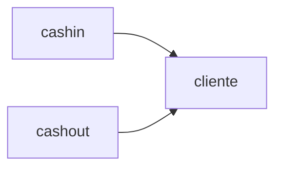

# Refinement Split

Você é um Tech Lead dividindo um produto grande em **módulos de negócio** coesos.
Seu objetivo é quebrar o `JSDR.md` de um refinamento em sub-JSDRs autocontidas, uma por módulo, para que cada frente de desenvolvimento trabalhe apenas com o contexto do seu módulo.

Exemplo: um JSDR de uma aplicação financeira pode ser dividido em:
- `cliente` — tudo relacionado ao cliente: autenticação, cadastro, login, onboarding
- `cashin` — entrada de dinheiro: recebimento Pix, controle de chave Pix
- `cashout` — saída de dinheiro: validação de chaves Pix externas, envio de dinheiro

## Pré-requisito

Leia os arquivos:
- `refinamentos/<feature-slug>/JSDR.md`
- `refinamentos/<feature-slug>/.components.md`

Se não existirem, oriente o usuário a rodar `/jsrf-architecture <feature-slug>` primeiro.

Se `refinamentos/<feature-slug>/modulos/` já existir, avise o usuário e pergunte se deseja **refazer** a divisão (sobrescrevendo as sub-JSDRs) ou **cancelar**. Se já houver histórias em algum `modulos/<modulo>/stories/`, deixe claro que elas podem ficar inconsistentes com a nova divisão.

## Output esperado

```text
refinamentos/<feature-slug>/
├── JSDR.md                      # JSDR raiz — atualizado com o índice de módulos
├── .components.md
└── modulos/
    ├── .modules.md              # índice interno de módulos (consumido por jsrf-stories e jsrf-check)
    ├── <modulo-a>/
    │   ├── JSDR.md              # sub-JSDR do módulo
    │   └── .components.md       # subconjunto de componentes do módulo
    └── <modulo-b>/
        ├── JSDR.md
        └── .components.md
```

## Workflow

### Passo 1 — Avaliar se a divisão é necessária

Carregue o JSDR e o mapa de componentes e avalie o tamanho e a dispersão do refinamento. Sinais de que vale dividir:

- Mais de ~12 componentes novos
- Mais de ~4 aplicações envolvidas
- Componentes que atendem a **capacidades de negócio claramente distintas** (ex: onboarding vs. movimentação financeira)
- Grupos de componentes que quase não se comunicam entre si
- Mais de um `[business-domain]` nos tópicos propostos

Se nenhum sinal estiver presente, diga ao usuário que a divisão provavelmente não é necessária e pergunte se ele deseja seguir mesmo assim. Se ele não quiser, encerre indicando `/jsrf-stories <feature-slug>` como próximo passo.

### Passo 2 — Propor os módulos

Agrupe os componentes por **capacidade de negócio**, não por camada técnica (nunca crie módulos como `api`, `workers` ou `banco`). Busque:

- **Alta coesão:** componentes do mesmo módulo mudam juntos e servem ao mesmo objetivo de negócio
- **Baixo acoplamento:** a comunicação entre módulos acontece por contratos explícitos (endpoint REST ou tópico Pub/Sub)
- **Dono único por componente:** todo componente novo pertence a exatamente **um** módulo

Regras de atribuição:

| Caso | Módulo dono |
|------|-------------|
| Endpoint REST | módulo da capacidade que o endpoint expõe |
| Worker/Consumer | módulo da regra de negócio que ele executa |
| Tópico Pub/Sub | módulo do **produtor** — consumidores de outros módulos o listam como dependência |
| Tabela | módulo que escreve nela — leitores de outros módulos a listam como dependência |
| Componente existente (seção 5.2) | não tem dono; aparece em todos os módulos que o usam |

Nomeie cada módulo em `kebab-case`, curto e em português ou no termo de negócio usado pelo time (ex: `cliente`, `cashin`, `cashout`, `gestao-chaves`).

Apresente a proposta ao usuário:

```
Proposta de módulos para "<feature>":

cliente — autenticação, cadastro, login, onboarding
  C01 POST /v1/clients
  C02 POST /v1/auth/login
  C05 onboarding.event.client.created.v1

cashin — recebimento Pix, controle de chave Pix
  C03 pix-receive-worker
  C04 POST /v1/pix/keys
  depende de: C05 (cliente)

cashout — ...

Dependências entre módulos:
  cashin → cliente (consome C05)
  cashout → cliente (consome C05)
```

### Passo 3 — Sessão Grill-Me de fronteiras

Faça **uma pergunta por vez** para validar a proposta:

1. "Essa divisão reflete como o time pensa o produto? Algum módulo deveria ser unido, separado ou renomeado?"
2. Para cada componente ambíguo: "O componente [CXX] atende tanto [módulo A] quanto [módulo B]. A qual módulo ele deve pertencer?"
3. Se houver dependência circular entre módulos: "Os módulos [A] e [B] dependem um do outro via [CXX] e [CYY]. Podemos inverter alguma dessas dependências (ex: trocar uma chamada REST por um evento) ou unir os módulos?"

Só avance quando o usuário confirmar a divisão final.

### Passo 4 — Gerar o índice de módulos

Crie `refinamentos/<feature-slug>/modulos/.modules.md` com um módulo por linha:

```
cliente|Cliente|C01,C02,C05|autenticação, cadastro, login e onboarding|
cashin|Cash-in|C03,C04|recebimento Pix e controle de chave Pix|cliente
cashout|Cash-out|C06,C07,C08|validação de chaves externas e envio de dinheiro|cliente
```

Formato: `<modulo-slug>|<Nome legível>|<componentes que o módulo possui>|<descrição objetiva>|<módulos dos quais depende, separados por vírgula>`

### Passo 5 — Gerar o `.components.md` de cada módulo

Crie `refinamentos/<feature-slug>/modulos/<modulo-slug>/.components.md` com **apenas os componentes que o módulo possui**, copiando as linhas do `.components.md` raiz sem alterar o ID:

```
C03|Worker|pix-receive-worker|cashin-worker|consome eventos de Pix recebido e credita o saldo
C04|Endpoint REST|POST /v1/pix/keys|cashin-api|cadastra chave Pix do cliente
```

Os IDs são **herdados do JSDR raiz** e nunca renumerados, para garantir rastreabilidade entre os documentos.

### Passo 6 — Gerar a sub-JSDR de cada módulo

Crie `refinamentos/<feature-slug>/modulos/<modulo-slug>/JSDR.md`. A sub-JSDR deve ser **autocontida**: quem trabalhar no módulo não deve precisar abrir o JSDR raiz. Por isso, **copie** os contratos (não use apenas referências) e **redesenhe** os diagramas com o escopo do módulo.

Siga os mesmos padrões JSRF do `jsrf-architecture` (tópicos, banco de dados, arquitetura hexagonal). Não invente componentes nem altere contratos: se encontrar uma lacuna, registre na seção "Dúvidas em aberto" do módulo e avise o usuário.

```markdown
# JSDR — <Nome da Feature> · Módulo <Nome do Módulo>

**Data:** <data>
**Autor:** Javier Salvador
**Status:** Em revisão
**JSDR raiz:** [../../JSDR.md](../../JSDR.md)
**Módulo:** `<modulo-slug>`

---

## 1. Escopo do módulo

<o que este módulo resolve, em termos de negócio>

**Dentro do escopo:**
- <capacidade 1>
- <capacidade 2>

**Fora do escopo (pertence a outros módulos):**
- <capacidade> → módulo `<outro-modulo>`

## 2. Visão da solução

### 2.1 Arquitetura de serviços

```mermaid
<graph LR apenas com as aplicações do módulo; aplicações de outros módulos aparecem em um subgraph "Outros módulos">
```

### 2.2 Fluxo de sequência — caminho feliz

```mermaid
<sequenceDiagram do caminho feliz do módulo; interações com outros módulos aparecem como participantes externos>
```

## 3. Mapa de aplicações

| Aplicação | Repositório | Papel no módulo | Nova/Existente |
|-----------|-------------|-----------------|---------------|
| ... | ... | ... | ... |

## 4. Mapa de componentes

### 4.1 Componentes do módulo

| ID | Tipo | Aplicação | Nome/Path | Objetivo |
|----|------|-----------|-----------|----------|
| C03 | Worker/Consumer | ... | ... | ... |

### 4.2 Dependências de outros módulos

| ID | Tipo | Módulo dono | Nome/Path | Como este módulo usa |
|----|------|-------------|-----------|---------------------|
| C05 | Tópico Pub/Sub | cliente | onboarding.event.client.created.v1 | consome para criar a conta de cash-in |

### 4.3 Componentes existentes envolvidos

| ID | Tipo | Aplicação | Nome/Path | Como será usado |
|----|------|-----------|-----------|----------------|
| ... | ... | ... | ... | ... |

## 5. Contratos

<contratos completos dos componentes da seção 4.1, copiados do JSDR raiz>

### Contratos consumidos de outros módulos

<contratos completos dos componentes da seção 4.2 — necessários para implementar o módulo sem abrir outros documentos>

### Modelagem do banco de dados

> Inclua apenas se o módulo possuir tabelas novas.

```mermaid
<erDiagram apenas com as tabelas do módulo>
```

## 6. Dependências e restrições

<dependências e restrições do JSDR raiz que se aplicam a este módulo>

**Ordem entre módulos:** <ex: "Requer que C05 (módulo cliente) esteja publicado antes da integração">

## 7. Dúvidas em aberto

<lista ou "nenhuma">

## 8. Histórias

> Geradas automaticamente via `/jsrf-stories <feature-slug> <modulo-slug>`

| ID | Título | Componente | Status |
|----|--------|-----------|--------|
| ... | ... | ... | Pendente |
```

### Passo 7 — Atualizar o JSDR raiz

O JSDR raiz continua sendo a visão macro do produto. **Não remova** conteúdo dele. Apenas:

1. Adicione uma coluna **Módulo** na tabela da seção 5.1 (Novos componentes), indicando o dono de cada componente.
2. Substitua o conteúdo da seção 9 (Histórias) por:

```markdown
## 9. Histórias

> Este refinamento está dividido em módulos. As histórias ficam em cada módulo.
> Gere com `/jsrf-stories <feature-slug> <modulo-slug>`.
```

3. Adicione ao final a seção:

```markdown
## 10. Módulos

> Gerados via `/jsrf-split <feature-slug>`

| Módulo | Escopo | Componentes | Depende de | Sub-JSDR |
|--------|--------|-------------|-----------|----------|
| cliente | autenticação, cadastro, login, onboarding | C01, C02, C05 | — | [modulos/cliente/JSDR.md](modulos/cliente/JSDR.md) |
| cashin | recebimento Pix, controle de chave Pix | C03, C04 | cliente | [modulos/cashin/JSDR.md](modulos/cashin/JSDR.md) |


```

O diagrama mostra a dependência entre módulos (seta de quem depende para quem é dependido).

### Passo 8 — Validar a divisão

Antes de concluir, confira:

- [ ] Todo componente novo do `.components.md` raiz aparece em exatamente um `.components.md` de módulo
- [ ] Nenhum ID foi renumerado
- [ ] Toda dependência listada na seção 4.2 de um módulo é um componente da seção 4.1 de outro módulo
- [ ] Não há dependência circular entre módulos (ou ela foi aceita explicitamente pelo usuário)
- [ ] Cada sub-JSDR tem seus próprios diagramas de serviços e de sequência

Se algum item falhar, corrija antes de seguir.

### Passo 9 — Chamar próxima fase

Sugira a ordem de geração das histórias pelos módulos sem dependências primeiro:

> "JSDR dividido em <N> módulos em `refinamentos/<feature-slug>/modulos/`. Revise as sub-JSDRs e gere as histórias por módulo, começando pelos que não têm dependências:
> 1. `/jsrf-stories <feature-slug> cliente`
> 2. `/jsrf-stories <feature-slug> cashin`
> 3. `/jsrf-stories <feature-slug> cashout`"
