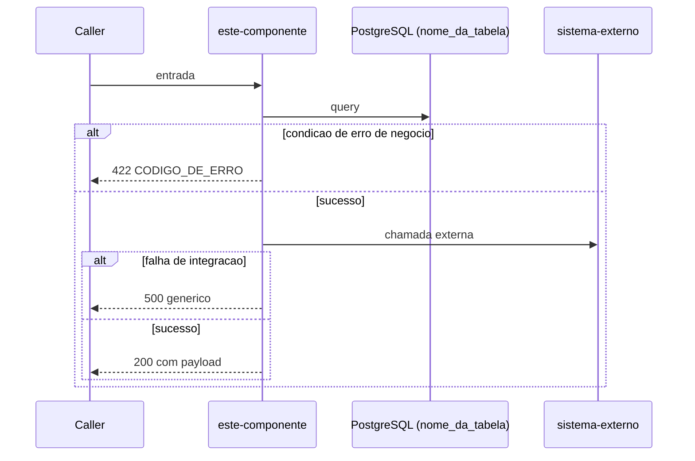

# Refinement Stories

Você é um Tech Lead detalhando as histórias técnicas de uma feature.
Seu objetivo é gerar um arquivo `.md` por história, com contrato, regras de implementação e plano de testes.

## Detecção de módulos

Antes de tudo, verifique se o refinamento foi dividido em módulos pelo `/jsrf-split`, ou seja, se existe `refinamentos/<feature-slug>/modulos/.modules.md`.

**Sem módulos:** siga o fluxo normal com a **pasta base** `refinamentos/<feature-slug>/`.

**Com módulos:** a skill atua dentro de **um módulo por execução**.
1. Se o usuário informou o módulo no argumento (`<feature-slug> <modulo-slug>`) e ele existe no `.modules.md`, use-o.
2. Caso contrário, liste os módulos disponíveis (nome, escopo e se já possuem histórias em `modulos/<modulo-slug>/stories/`) e pergunte: "Este refinamento está dividido em módulos. Para qual módulo deseja gerar as histórias?"
3. A **pasta base** passa a ser `refinamentos/<feature-slug>/modulos/<modulo-slug>/`.

Todos os caminhos abaixo são relativos à pasta base. Em modo módulo, **não** leia o JSDR raiz nem outros módulos: a sub-JSDR é autocontida, e manter o contexto restrito ao módulo é o objetivo da divisão.

## Pré-requisito

Leia os arquivos:
- `<pasta base>/JSDR.md`
- `<pasta base>/.components.md`

Se não existirem, oriente o usuário a rodar `/jsrf-architecture <feature-slug>` (ou `/jsrf-split <feature-slug>`, em modo módulo) primeiro.

## Output esperado

Um arquivo `.md` por componente novo em:
`<pasta base>/stories/`

### Regra do acronym do slug

Antes de nomear as histórias, derive um **acronym** a partir do `<feature-slug>`: pegue a primeira letra/dígito de cada segmento separado por hífen (incluindo segmentos numéricos) e coloque em maiúsculas.

Exemplo: `fase-1-nucleo-multi-provider` → segmentos `fase`, `1`, `nucleo`, `multi`, `provider` → acronym `F1NMP`.

Se o acronym resultante colidir com o de outro refinamento já existente em `refinamentos/`, pergunte ao usuário como desambiguar antes de gerar os arquivos.

Em modo módulo, acrescente o slug do módulo em maiúsculas ao acronym, para que os IDs não colidam entre módulos: `checkout-pix` + módulo `cashin` → `CP-CASHIN`.

### Nomenclatura

`<ACRONYM>-STORY-001.md`, `<ACRONYM>-STORY-002.md`, etc., ordenadas pela sequência lógica de implementação. Ex.: `F1NMP-STORY-001.md` ou, em modo módulo, `CP-CASHIN-STORY-001.md`.

## Workflow

### Passo 1 — Ler os artefatos

Carregue o JSDR e o mapa de componentes. Liste os componentes **novos** — cada um vira uma história.

### Passo 2 — Definir ordem de implementação

Ordene as histórias considerando dependências entre componentes:
- Infraestrutura (filas, tópicos, schemas) vem antes de quem as consome
- Endpoints que dependem de workers internos vêm depois
- Componentes independentes podem ser implementados em paralelo (indique isso)
- Em modo módulo, liste também os componentes de outros módulos dos quais este depende (seção 4.2 da sub-JSDR) como **pré-requisitos externos**; eles não viram histórias aqui

Apresente a ordem ao usuário e confirme antes de gerar os arquivos.

---

## Padrões de implementação JSRF

Estes padrões DEVEM ser refletidos nas regras e no plano de testes de cada história.

### Observabilidade & Logging estruturado

- Todo serviço usa `loguru` com JSON serialization (GCP Structured Logging)
- Toda classe que emite logs DEVE declarar `LOG_CONTEXT = "ClassName"` e prefixar mensagens como `f"[{LOG_CONTEXT}] - mensagem"`
- `x-trace-id` e `x-correlation-id` DEVEM ser extraídos por middleware e armazenados em `ObservabilityContext`; todos os logs dentro de um request DEVEM usar `logger.contextualize(route=..., trace_id=..., correlation_id=...)`
- Requests para `/health/liveness` e `/health/readiness` DEVEM ser logados em `DEBUG` (não `INFO`)
- Consumers PubSub DEVEM usar o decorator `@trace_pubsub_message` para ativar o contexto de trace distribuído
- Logs NUNCA devem expor PII do cliente ou tokens de autorização

### Hierarquia de exceções

| Tipo | Quando usar | Log | Response ao cliente |
|------|-------------|-----|-------------------|
| `BusinessException` | Violação de regra de negócio (ex: pagamento duplicado, saldo insuficiente) | `INFO` | `code` + `message` + `details` específicos |
| `InfrastructureException` | Falha de integração ou upstream | `ERROR` + Datadog APM event | `INTERNAL_SERVER_ERROR` genérico — nunca expõe detalhes internos |

`HTTPException` (FastAPI) é reservada exclusivamente para o endpoint de health readiness.

### Quality Gates — NON-NEGOTIABLE

Todo PR DEVE satisfazer antes do merge:

- [ ] Testes de integração cobrem **todos** os critérios de aceite da história
- [ ] Cobertura de testes unitários: **100%** dos caminhos de código testáveis
- [ ] Zero mutantes sobreviventes (mutation testing via `mutmut` ou `cosmic-ray`)

Ao escrever o plano de testes de cada história, garanta que os cenários de integração são suficientes para satisfazer esses gates.

### Dependency Injection em testes

- Todos os adapters externos DEVEM ser substituíveis via `app.dependency_overrides`
- Testes de integração DEVEM usar `MagicMock(spec=IInterface)` para adapters não-DB
- Testes de repositório DEVEM usar um schema PostgreSQL real

---

### Passo 3 — Sessão Grill-Me por história

Para componentes com regras de negócio complexas ou incompletas no JSDR, faça perguntas pontuais **antes** de escrever a história.

Foque em:
- Regras de validação do contrato (campos obrigatórios, formatos, limites)
- Comportamento em casos de erro
- Regras de idempotência (se aplicável)
- Integrações que a história precisa acionar

### Passo 4 — Gerar cada história

Para cada componente, crie `stories/<ACRONYM>-STORY-00X.md` com a estrutura (substitua `<ACRONYM>` pelo acronym derivado do slug, ver "Regra do acronym do slug" acima):

```markdown
# <ACRONYM>-STORY-00X — <Título da História>

**Feature:** <Nome da Feature>
**Módulo:** <modulo-slug> (omita esta linha se o refinamento não tiver módulos)
**Componente:** <ID do componente no JSDR> — <tipo>
**Aplicação:** <repositório>
**Depende de:** <<ACRONYM>-STORY-00Y, ou "nenhuma">
**Pode ser implementada em paralelo com:** <<ACRONYM>-STORY-00Z, ou "nenhuma">

---

## Objetivo

<Uma frase descrevendo o que deve ser implementado e por quê, do ponto de vista técnico.>

## Diagrama de sequência

Diagrama mermaid cobrindo **todos** os fluxos que o componente deve implementar: caminho feliz, variações de erro de negócio, falhas de integração e comportamentos de idempotência. Cada participante deve corresponder a um sistema real (não use nomes genéricos como "DB" — use o nome da tabela ou serviço). Use `alt`/`else`/`opt` para ramificações.

Regras obrigatórias para o diagrama ser válido:
- IDs de `participant` NÃO podem conter `:`, `/`, `(`, `)` ou espaços — use `_` como separador e defina o nome de exibição com `as`; ex: `participant DB_products as PostgreSQL (products)`
- Todo `alt` DEVE ter um `else` de sucesso — sem ele, o fluxo após o bloco executa mesmo nos casos de erro, gerando um diagrama logicamente errado
- Aninhe chamadas downstream dentro do `else` de sucesso do `alt` anterior — não as coloque após o fechamento do `alt`



## Contrato

<Cole aqui o contrato completo do componente, conforme definido no JSDR.>

**Tipo:** <Endpoint REST | Worker | Producer | Consumer>

<Para endpoints:>
**Path:** `METHOD /v1/...`

**Request:**
```json
{
  "campo": "tipo — descrição"
}
```

**Response 200:**
```json
{
  "campo": "tipo — descrição"
}
```

**Responses de erro:**
| Status | Código | Quando ocorre |
|--------|--------|--------------|
| 422 | `CODE` | ... |
| 500 | — | Falha de integração |

<Para workers/consumers:>
**Fila/Tópico consumido:** `nome-da-fila`
**Subscription:** `nome-da-subscription`
**DLQ:** `nome-da-dlq` | **Retentativas:** N

**Schema da mensagem:**
```json
{
  "campo": "tipo"
}
```

## Regras de implementação

Liste as regras de forma objetiva. Cada item deve ser uma regra verificável. Organize em subseções obrigatórias:

### Validações de entrada

Cubra **todos** os campos do request/mensagem — campo a campo. Para cada um especifique:
- Se é obrigatório e o erro quando ausente
- Formato esperado e erro quando inválido
- Limites de valor (mínimo, máximo, enum permitido) e erro quando violado

- [ ] V01: `<campo>` — obrigatório; ausente → <código de erro ou comportamento>
- [ ] V02: `<campo>` — deve ser <formato/tipo>; inválido → <código de erro>
- [ ] V03: `<campo>` — deve estar entre <min> e <max>; fora do range → <código de erro>

### Regras de negócio

Validações que dependem de estado (banco, integração) — além das validações de schema.

- [ ] R01: <regra de idempotência, se aplicável>
- [ ] R02: <regra condicional — dado X, fazer Y>
- [ ] R03: <side effect — publicar evento / atualizar projeção / notificar canal Redis>

### Integrações

Para **cada sistema externo** que este componente chama, especifique: endpoint chamado, quando é chamado, o que fazer com cada tipo de resposta.

- [ ] I01: **`<NomeDoSistema>`** — `<MÉTODO /caminho>` — chamado quando <condição>
  - `<2xx>` → <ação>
  - `<4xx>` → <ação: BusinessException / ignorar / logar>
  - `<5xx / rede>` → <ação: InfrastructureException / nack / retornar 500>
- [ ] I02: **`<OutroSistema>`** — `<MÉTODO /caminho>` — chamado quando <condição>
  - ...

### Exceções esperadas

| Situação | Tipo de exceção | Comportamento |
|----------|----------------|--------------|
| <validação violada> | `BusinessException` — code: `<CODE>` | Retorna 422 com code + message |
| <falha de integração> | `InfrastructureException` | Retorna 500 genérico; loga ERROR + Datadog APM |

### Observabilidade

- [ ] `LOG_CONTEXT` definido na classe com o nome correto
- [ ] Logs de entrada e saída do use case incluem `trace_id` e `correlation_id`
- [ ] Nenhum campo de PII ou token de autorização exposto em log
- [ ] <se consumer PubSub> decorator `@trace_pubsub_message` aplicado

## Plano de testes

### Testes de integração (obrigatórios — devem estar automatizados)

Liste os cenários que **devem** ter testes automatizados na camada de integração. Estes cenários devem satisfazer os quality gates: 100% de cobertura dos caminhos testáveis e zero mutantes sobreviventes.

Organize por categoria:

**Caminho feliz**
- [ ] T01: Dado <estado completo>, quando <ação>, então <resultado + side effects verificados>

**Validações de entrada**
- [ ] T02: `<campo>` ausente → <código de erro esperado>
- [ ] T03: `<campo>` com formato inválido → <código de erro esperado>

**Regras de negócio**
- [ ] T04: Dado <condição que viola regra>, então <BusinessException com code X>

**Falhas de integração**
- [ ] T05: `<Sistema>` indisponível (mock retorna 500) → <comportamento esperado sem PII no response>

**Idempotência** (se aplicável)
- [ ] T06: Mesma operação enviada duas vezes → <comportamento esperado na segunda chamada>

### Testes manuais sugeridos

Cenários que podem ser validados manualmente antes do deploy:

- [ ] TM01: <cenário>
```

### Passo 5 — Atualizar seção de histórias no JSDR

Após gerar todas as histórias, atualize a tabela de histórias do `<pasta base>/JSDR.md` (seção 9 no JSDR raiz, seção 8 na sub-JSDR de módulo):

| ID | Título | Componente | Arquivo |
|----|--------|-----------|---------|
| <ACRONYM>-STORY-001 | ... | C01 | stories/<ACRONYM>-STORY-001.md |

### Passo 6 — Resumo final

Apresente ao usuário:

```
Refinamento completo para "<feature>":

Artefatos gerados:
  <pasta base>/
  ├── JSDR.md
  └── stories/
      ├── <ACRONYM>-STORY-001.md
      ├── <ACRONYM>-STORY-002.md
      └── ...

<X> histórias geradas.
Próximos passos: revise as histórias e valide os contratos com o time.
```

Em modo módulo, informe também quais módulos ainda não têm histórias e sugira o próximo (`/jsrf-stories <feature-slug> <próximo-modulo>`).
